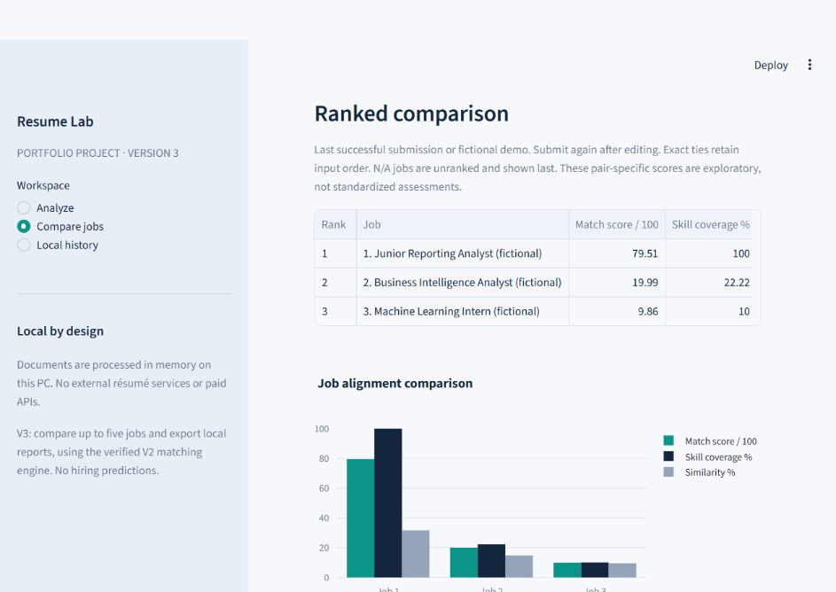
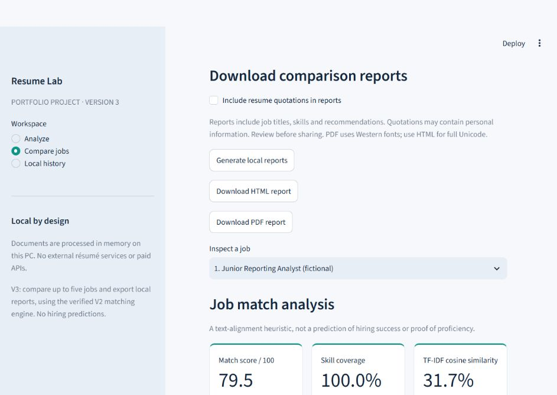

# AI Resume & Job Match Analyzer

**A local Python application for exploring resume-to-role alignment with transparent scoring.**

This portfolio project combines document processing, text analytics, interactive dashboards,
and SQLite persistence in a modular Streamlit application. It extracts resume content,
compares recognized skills with job requirements, and helps users inspect the evidence behind
skill gaps and suggested learning priorities.

Despite the project name, the current implementation uses deterministic rules and local
TF-IDF calculations, not a generative AI service or trained semantic model. No API key is needed.
**Scores are analytical aids, not predictions of hiring success, ATS outcomes, or proficiency.**

## Features

| Capability | Current implementation |
| --- | --- |
| Resume extraction | PDF and DOCX uploads; extracted text, document statistics, and actionable validation errors |
| Skill matching | Case-insensitive taxonomy aliases, whole-token boundaries, matched skills, not-detected skills, and explicitly related skills |
| Transparent scoring | Unique-skill coverage and two-document TF-IDF cosine similarity, with separate contributions and Plotly charts |
| Job Title Intelligence | Built-in role profiles, title aliases, automatic detection, and manual role selection |
| Custom role profiles | Preview skills extracted from a detailed description; explicitly save, edit, reuse, or delete a local profile |
| Optional learning advice | Prioritized gaps, prerequisites, practice tasks, approximate learning times, completion goals, and a suggested four-week plan |
| Evidence-based editing | Optional bullet-editing prompts grounded in existing resume lines; no invented achievements |
| Multi-job comparison | Compare one resume with up to five jobs, inspect ranked results, and explore interactive comparison charts |
| Reports | Generate local PDF and HTML comparison reports with methodology, skills, and recommendations |
| Local history | Opt-in numeric document summaries in SQLite; comparison results remain in session memory |

### Supported roles and custom profiles

The built-in catalog includes Data Analyst, Business Analyst, Data Scientist, Software Engineer,
Python Developer, Java Developer, Web Developer, Frontend Developer, Backend Developer,
Full Stack Developer, Machine Learning Engineer, and Database Administrator.

- A recognized title such as `Data Analyst job` can use its predefined profile without a full description.
- A sufficiently detailed description replaces generic built-in or saved requirements with its recognized skills.
- An unknown title with a valid description produces a temporary profile using the same taxonomy.
- **Preview role skills** shows essential, preferred, and unspecified mentions before analysis or saving.
- **Save this role locally** persists only the reviewed title and skill metadata. **Edit saved roles** updates skills and importance or deletes the profile after confirmation. Duplicate titles are rejected without overwriting existing profiles.

Profile extraction is a deterministic summary of skill mentions, not a model that learns new
skills. Unknown titles without sufficient description evidence remain unscored.

## Technology stack

| Layer | Technology |
| --- | --- |
| Application and UI | Python, Streamlit |
| Document parsing | pypdf, python-docx |
| Text analytics | Python standard library: regular expressions, counters, and math |
| Visualization | Plotly |
| Persistence | SQLite through Python's `sqlite3` module |
| Export | ReportLab for PDF; escaped HTML generated locally |
| Verification | pytest and Streamlit AppTest |

Dependency ranges are maintained in [requirements.txt](requirements.txt). There are no external
AI APIs, model downloads, or additional data-service dependencies.

## Architecture and project structure

The UI validates inputs and extracts document text in memory. Role resolution supplies either
a catalog profile or the recognized requirements from a description. Single-job and comparison
workflows call the same matching engine. Optional advice uses those gaps and predefined learning
guidance. Persistence is separate from scoring; reports are generated in memory.

```text
ai-resume-job-match-analyzer/
|-- app.py                       Streamlit entry point
|-- run.ps1                      Project-aware Windows launcher with port check
|-- requirements.txt             Runtime and test dependencies
|-- .streamlit/config.toml       Navy/teal theme, loopback binding, telemetry disabled
|-- .gitignore                   Local data, credentials, caches and report exclusions
|-- .gitattributes               Preserve PDF, DOCX and PNG bytes in Git
|-- resume_analyzer/
|   |-- ui.py                    Single-job input, analysis tabs and history view
|   |-- parsing.py               PDF/DOCX extraction and file validation
|   |-- analysis.py              Text validation and descriptive statistics
|   |-- taxonomy.py              Canonical skills, aliases and related pairs
|   |-- matching.py              Shared coverage, TF-IDF and validation logic
|   |-- role_skills.py           Built-in profiles and description-based resolution
|   |-- custom_roles.py          Separate SQLite store for approved custom roles
|   |-- role_ui.py               Profile preview/edit controls and advice preference
|   |-- roadmap.py               Deterministic priorities, exercises and learning plan
|   |-- roadmap_ui.py            Roadmap presentation
|   |-- suggestions.py           Source-grounded bullet-editing prompts
|   |-- match_ui.py              Detailed scores, skill lists and charts
|   |-- comparison.py            Batch validation and ranking using the shared engine
|   |-- comparison_ui.py         Comparison forms, charts and report downloads
|   |-- reports.py               In-memory HTML and PDF exports
|   `-- persistence.py           Parameterized SQL for numeric history
|-- tests/                       Parsing, scoring, role, roadmap, report and UI tests
|-- samples/                     Clearly labeled fictional resumes and job descriptions
|-- scripts/generate_samples.py  Rebuild fictional PDF/DOCX fixtures
|-- docs/screenshots/            Existing fictional-demo screenshots
`-- data/                       Local SQLite files; ignored by Git
```

## Installation on Windows

The project is verified with Python 3.12. Install Python 3.12 with the Windows `py` launcher,
Git, and optionally VS Code. In PowerShell:

```powershell
git clone https://github.com/DevPanwar003/ai-resume-job-match-analyzer.git
cd ai-resume-job-match-analyzer
py -3.12 -m venv .venv
.\.venv\Scripts\python.exe -m pip install -r requirements.txt
```

If the project is already cloned, open its existing folder and reuse `.venv`.
In VS Code, select `.venv\Scripts\python.exe` as the Python interpreter.
These commands do not require virtual-environment activation or an execution-policy change.
Dependency installation needs internet access; normal analysis runs locally afterward.

### Run the application

Run from the project root so Streamlit loads `.streamlit/config.toml`:

```powershell
.\.venv\Scripts\python.exe -m streamlit run app.py --server.address 127.0.0.1 --server.port 8502
```

Open [http://127.0.0.1:8502](http://127.0.0.1:8502). Stop with **Ctrl+C**.
Alternatively, run `.\run.ps1`; it selects this project's interpreter and refuses to start
when port 8502 is occupied. If PowerShell blocks scripts, use the explicit Python command
above. Stop an existing instance before restarting after source changes.

## Try the fictional demo

1. In **Analyze**, expand **Try fictional sample documents** and select **Run fictional demo**. This uses the real parser and matcher without saving history.
2. Inspect the score breakdown, matched/not-detected skills, document statistics, and extracted text.
3. Enable **Show skill improvement advice** to reveal the roadmap and bullet-editing prompts. It defaults off and retains its preference across navigation in the same session; toggling it does not change scores or clear results.
4. In **Compare jobs**, select **Run three-job fictional demo** to compare reporting, business intelligence, and machine learning opportunities.
5. Select **Generate local reports** to enable PDF and HTML downloads. Reports include recommendations independently of the on-screen advice toggle; resume quotations require a separate opt-in.

For your own input, upload a PDF/DOCX and enter a title or description, or select a role.
Use **Preview role skills** to review the profile, then submit the analysis. In comparison mode,
a supported title or explicit role selection can supply a profile when the description is empty.
Submit again after editing inputs to replace the previous result snapshot.

All sample identities and experience are fictional. The TXT resume is a fixture source, not a
supported upload format. Rebuild the sample documents only when needed:

```powershell
.\.venv\Scripts\python.exe scripts\generate_samples.py
```

## Scoring methodology

```text
skill coverage = unique matched skills / unique recognized job skills
match score    = 100 × (0.70 × skill coverage + 0.30 × TF-IDF cosine similarity)
```

Aliases and repeated mentions count once toward coverage. Related skills earn no exact-match
credit. Essential/preferred labels guide learning priorities; every recognized job skill has
equal weight in coverage. The 70/30 weights are design choices, not learned hiring weights.

TF-IDF uses the two input texts, normalized word tokens, an explicit English stopword list,
sublinear term frequency `1 + ln(count)`, smoothed IDF `1 + ln(3 / (1 + document frequency))`,
and L2 cosine normalization. For title-only analysis, it compares the resume against generated
profile text, which is visible in the analysis. It is lexical similarity, not skill coverage.

Without a recognized role profile, a description needs at least 20 word tokens, 10 distinct
tokens, task/requirement context, and a recognized taxonomy skill. Insufficient evidence or no
recognized resume skills yields **N/A** coverage and match score, with similarity shown separately.
Valid but disjoint skill sets can have zero coverage. Ranking uses unrounded scores; ties retain
input order and unavailable scores appear last.

## Tests

From the project root, use the existing virtual environment and Windows temporary-directory
workaround:

```powershell
New-Item -ItemType Directory -Force -Path "C:\pytest-temp" | Out-Null
$env:TEMP = "C:\pytest-temp"
$env:TMP = "C:\pytest-temp"
.\.venv\Scripts\python.exe -m pytest -q -p no:cacheprovider --basetemp="C:\pytest-temp\resume-v2"
```

The directory must be writable. Pytest manages and clears the `resume-v2` subfolder; never store
personal files there. If `C:\pytest-temp` is not writable, choose a user-writable directory and
update all three paths consistently. Disabling the cache provider avoids the known cache
permission issue on Windows.

The suite covers document formats and invalid inputs, alias boundaries, scoring calculations,
role resolution and refinement, custom-profile persistence, roadmap ordering, advice visibility,
multi-job consistency, reports, history privacy, and Streamlit interactions. It uses fictional
fixtures and temporary test databases. The current suite contains **138 tests**; run it locally
to verify your environment. Test counts are not performance or hiring-effectiveness metrics.

## Screenshots

These existing screenshots show the fictional V3 comparison demo and report controls. They
predate the latest role-management and optional-advice controls and are not a complete view of
the current interface. No screenshots were fabricated or generated for this documentation.

### Ranked comparison and chart



### Report download controls



## Privacy and local storage

- The app binds to `127.0.0.1`; document extraction and matching run locally. Streamlit usage telemetry is disabled. The application does not send resume content to external services.
- Uploaded documents and extracted text are processed in memory, not automatically saved as source files. Clear session inputs/results or stop the app when finished.
- Optional history in `data/history.sqlite3` stores timestamps, format, size, page count, and word/character counts, not filenames or source text. Comparison does not write history rows.
- Explicitly saved custom profiles in `data/custom_roles.sqlite3` contain a custom title and canonical skill metadata. Avoid personal information in titles. Built-in roles are not overwritten.
- SQLite data is local and unencrypted. Both stores use parameterized SQL values and are excluded from Git. History deletion and custom-role deletion are separate controls.
- Exported reports can contain job titles and skill summaries; quotations may contain personal information when enabled. Review reports before sharing. Downloaded files remain until you delete them.
- `.gitignore` excludes virtual environments, caches, local databases, secrets, environment files, private uploads, and generated report directories. PDF/DOCX files are ignored except the named fictional fixtures. `.env.example` is permitted only for non-secret placeholders. Ignore rules do not sanitize files; review every staged upload.

## Limitations

- Skill mentions do not prove proficiency. Missing means **not detected**, not that the person lacks a skill. Negation, experience duration, and nuanced requirements are not reliably interpreted.
- The English-oriented taxonomy and illustrative role profiles are incomplete. Aliases can be ambiguous; description extraction cannot infer skills outside the taxonomy.
- TF-IDF measures wording rather than meaning. Repetition, document length, and extraction errors can affect scores. Pair-specific scores are exploratory and not standardized applicant rankings.
- PDF/DOCX uploads are limited to 5 MiB; PDFs to 50 pages; declared expanded DOCX content to 25 MiB. Scanned PDFs need external OCR. Encrypted PDFs are unsupported.
- Complex PDF layouts can alter reading order. DOCX extraction includes body paragraphs and tables, not headers, footers, or text boxes; it does not calculate page counts.
- PDF reports use Western fonts and may replace unsupported characters. HTML preserves Unicode. Reports contain text summaries, not interactive charts or the four-week roadmap.
- Learning times and the four-week plan are suggestions for introductory practice, not guarantees of mastery or job readiness. The plan focuses on the first one or two priorities.
- This is a local portfolio application for trusted documents, not a hardened public upload service or hiring decision system.

## Portfolio summary

**Project summary:** A Python and Streamlit application that turns PDF/DOCX resumes and job
requirements into explainable skill-alignment dashboards. It combines local text processing,
role-profile management, optional learning guidance, multi-job comparison, report generation,
and SQLite persistence in a tested modular codebase.

**Resume-ready description:** Built a local resume and job-match analyzer using Python,
Streamlit, Plotly, and SQLite; implemented document extraction, taxonomy-based skill matching,
transparent TF-IDF scoring, custom role profiles, comparison reports, and automated regression tests.

## Future improvements

Potential next steps, **not currently implemented**:

- Expand taxonomy coverage with curated examples and regression tests for ambiguous wording.
- Improve requirement classification and negation handling while keeping decisions explainable.
- Evaluate extraction and matching quality against a labeled, consented or synthetic dataset.
- Improve Unicode PDF rendering and accessibility of dashboard controls.
- Explore local OCR with explicit user control and documented resource costs.
